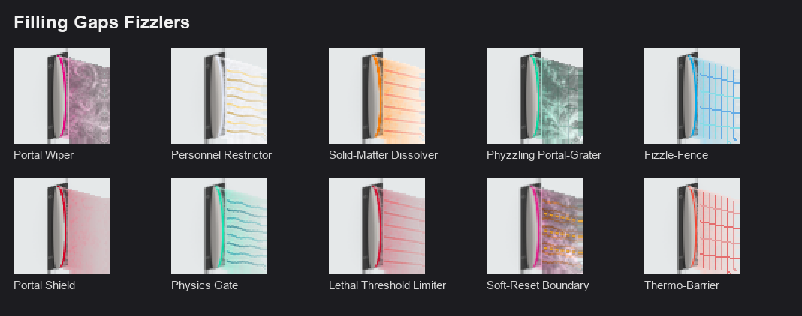
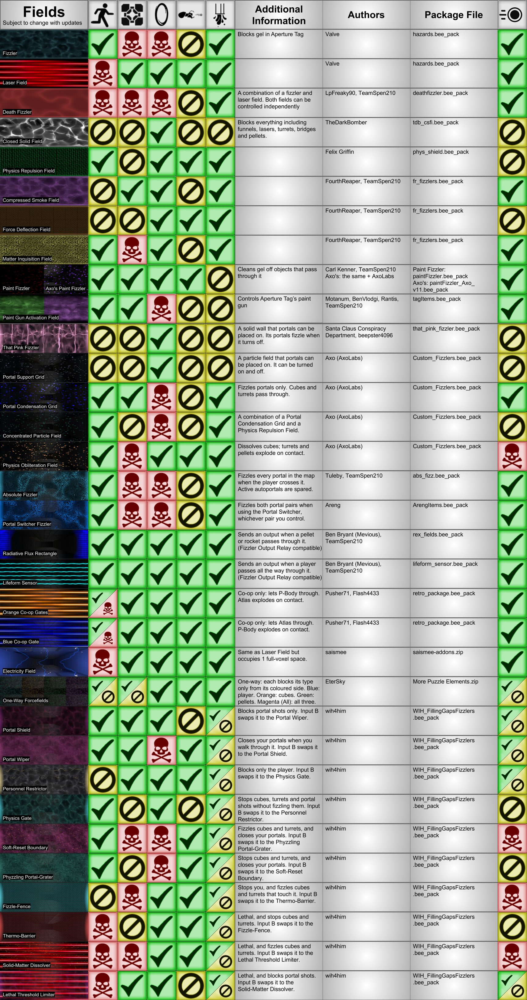

# Filling Gaps Fizzlers

> **Download:** [WIH_FillingGapsFizzlers.bee_pack](https://github.com/wih4him/wih-custom-beepacks/releases/latest/download/WIH_FillingGapsFizzlers.bee_pack). Put that one file in BEEmod's `packages` folder as it is (don't unzip it) and restart BEEmod. Don't use the green **Code > Download ZIP** button: that zip is the source, not a package.

Five two-function fizzlers for BEEmod (BEE2) and Portal 2. The "gaps" they fill are the remaining combinations of basic custom fizzler types, based on all the custom fizzlers the community has made so far. Together, their ten fizzlers complete the relevant combinations in the original chart (see [Where they fit](#where-they-fit)).

Each item holds two fizzlers. The editor dropdown picks which function the item starts as. While you play, input B swaps the fizzler from its current function to its paired function and back again (see Inputs and outputs), and input A turns the field on and off.

| Item | First function | Second function |
|---|---|---|
| Portal Wiper / Portal Shield | **Portal Wiper** (magenta, with a fractal pattern): walk through the field and your open portals close, and in co-op the other player's too. You, cubes, turrets and portal shots pass. | **Portal Shield** (burgundy, with slow violet swirls): the field stops portal shots and nothing else. |
| Personnel Restrictor / Physics Gate | **Personnel Restrictor** (silver, with gold strands): only you are stopped. Cubes, turrets, portals and portal shots pass. | **Physics Gate** (aquamarine, with teal strands and slow turquoise spirals): cubes, turrets and portal shots are stopped without being fizzled. You and your portals pass. |
| Solid-Matter Dissolver / Lethal Threshold Limiter | **Solid-Matter Dissolver** (red laser beams with orange sparks): you die on touch, cubes and turrets are fizzled, and portals and portal shots pass. | **Lethal Threshold Limiter** (laser beams over a burgundy field): you die on touch, cubes and turrets pass, and portal shots are stopped. |
| Phyzzling Portal-Grater / Soft-Reset Boundary | **Phyzzling Portal-Grater** (dark seafoam, with fractal spirals and a sliding mesh): cubes and turrets are stopped at the field, walking through the field closes your open portals, and you and your portal shots pass. | **Soft-Reset Boundary** (magenta, over an orange particle field): cubes and turrets are fizzled, walking through the field closes your open portals, and you and your portal shots pass. |
| Fizzle-Fence / Thermo-Barrier | **Fizzle-Fence** (white-blue bars): you are stopped at the field, cubes and turrets that touch the field are fizzled, and portals and portal shots pass. | **Thermo-Barrier** (a red grate): you die on touch, cubes and turrets are stopped at the field, and portals and portal shots pass. |

## Options (right-click a placed fizzler)

- **Start Enabled:** with Start Enabled ticked, the field is on when the map starts. With Start Enabled unticked, the field starts off until input A turns the field on.
- **Start Open:** with Start Open ticked, pellets bounce off the Portal Wiper, Portal Shield, Personnel Restrictor and Lethal Threshold Limiter, but only while the field is on and visible. The other six fizzlers already stop or destroy pellets.
- **Start Reversed:** with Start Reversed ticked, the field also stops gel and glows in its own colour, but only while the field is on and visible.

## Inputs and outputs

- **Input A** switches the field on and off. A plain wire (from a button or an antenna, for example) goes to input A.
- **Input B** swaps the fizzler from its current function to its paired function, and back again, while you play. The five pairs are:
  - Portal Wiper and Portal Shield
  - Personnel Restrictor and Physics Gate
  - Solid-Matter Dissolver and Lethal Threshold Limiter
  - Phyzzling Portal-Grater and Soft-Reset Boundary
  - Fizzle-Fence and Thermo-Barrier

  Wire input B through an item that sends to input B, such as BEEmod's SR strip.
- **Fizzler Output Relay:** place one on a fizzler to wire that fizzler to other items. The relay's output is on while the field is on. While the field is on, something crossing the field switches the relay's output off for a moment; each item's description lists which crossings count. The relay's Timer sets how long that moment lasts, and its countdown sign counts down while the relay's output is off.

## Install

1. Download [`WIH_FillingGapsFizzlers.bee_pack`](https://github.com/wih4him/wih-custom-beepacks/releases/latest/download/WIH_FillingGapsFizzlers.bee_pack) from the [Releases page](https://github.com/wih4him/wih-custom-beepacks/releases/latest). The green Code > Download ZIP button gives the source instead, which BEEmod can't load as it is. The unpacked contents are in `packages/FillingGapsFizzlers/`.
2. Put the `.bee_pack` file in BEEmod's `packages` folder as it is. Don't unzip it. If an older Filling Gaps Fizzlers file is there, remove it first: BEEmod will not load two copies.
3. Restart BEEmod. The five items have the tag "Fizzlers". In BEEmod's item list they come right after Portal 2's own items.

Made and tested with BEEmod 4.46.1. The Fizzler Output Relay is one of BEEmod's own standard packages. Portal 2 is required.

## Good to know

- The Portal Wiper, the Phyzzling Portal-Grater and the Soft-Reset Boundary close your portals the way Portal 2's own Emancipation Grill does, so the crosshair empties too.
- Start Reversed's glow uses the engine's dynamic lights, two per fizzler. Portal 2 draws at most 32 at once, so a map with more than 16 glowing fizzlers will lose some of the glow.

## Where they fit

How these ten compare with the other fields in Portal 2 and the community's packages (what each lets through, by whom, in which package):

## Credits

The editor models and the Fizzle-Fence / Thermo-Barrier material are FourthReaper's Force Deflection Field model and material, recoloured. The moving layers of the Portal Wiper, the Phyzzling Portal-Grater and the Soft-Reset Boundary use the animation timing of Felix Griffin's Physics Repulsion Field. The palette icons are drawn over BEEmod's stock fizzler icon. The orange particle is Valve's own, recoloured. See [CREDITS.md](CREDITS.md) for the full credits and for which licence covers which files.

## Licence

- **Code** (VScripts, item configuration, instances): MIT, see [LICENSE](LICENSE). © 2026 William Isaiah Hardwick.
- **Original artwork** (field textures, the chart, and wih4him's additions to the icons): CC BY 4.0, see [LICENSE-ASSETS](LICENSE-ASSETS).
- **Not covered:** Valve-derived files (models, materials, particles, sounds) remain Valve's property, included for free, non-commercial use with Portal 2. FourthReaper's editor models and material remain FourthReaper's. The 24 materials that use Felix Griffin's animation timing are credited to him and left out of the MIT licence. BEEmod's selection box and base icon remain BEEmod's. [CREDITS.md](CREDITS.md) lists which files these are.

Assets may be redistributed as part of compiled Portal 2 maps.

Not affiliated with or endorsed by Valve.
